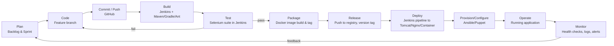

# Task 2 — Agile Planning & DevOps Workflow
## Agricultural Market Price Tracker (AMPT)

Baseline: `docs/01-problem-definition-scope.md` (15-task frozen MVP scope)

---

## 1. Product Backlog

Priority: **H**igh / **M**edium / **L**ow. Points on a 1–5 scale (1 = trivial, 5 = complex).

| ID | Area | Backlog Item | Priority | Points |
|----|------|--------------|----------|--------|
| B01 | Foundation | Define data model (Market, Commodity, PriceRecord, User/Role) | H | 3 |
| B02 | Foundation | Project skeleton, build tool config, local DB schema/migration | H | 3 |
| B03 | Entry | Price-entry form (create) with validation | H | 3 |
| B04 | Entry | Edit/correct existing price record (update) | H | 2 |
| B05 | Entry | Role check — only authorized roles enter/edit | M | 2 |
| B06 | Dashboard | Search API + UI (market, commodity, date range) | H | 4 |
| B07 | Dashboard | Paginated, sortable results list | M | 2 |
| B08 | Summary | Compute today's avg/modal price per commodity | H | 3 |
| B09 | Summary | Compute % change vs previous reporting day | H | 3 |
| B10 | Summary | Dashboard indicator widgets | M | 2 |
| B11 | Drill-down | Click-through from indicator to record list | M | 2 |
| B12 | Drill-down | Single-record / full-history detail view | M | 3 |
| B13 | Alerts | Rule: flag price change beyond threshold | H | 3 |
| B14 | Alerts | Rule: flag market missing today's data | M | 2 |
| B15 | Alerts | Alerts/exceptions list view | M | 2 |

**Total points: 39** (used only to size the single MVP sprint — see §4)

---

## 2. User Stories & Acceptance Criteria

Format: `As a <role>, I want <capability>, so that <benefit>` + Given/When/Then AC.

**B01 — Data model**
> As a developer, I want a clear data model for markets, commodities, price records
> and users, so that every later feature has a stable schema to build on.
- **AC1:** Given the schema is applied, when I inspect the DB, then `Market`,
  `Commodity`, `PriceRecord`, `User` tables exist with foreign keys linking
  `PriceRecord` → `Market` and `PriceRecord` → `Commodity`.
- **AC2:** Given a `PriceRecord`, when it is saved, then `date`, `min_price`,
  `max_price`, `modal_price`, and `arrival_qty` are all required fields.

**B02 — Project skeleton**
> As a developer, I want a runnable local skeleton, so that I can start building
> features immediately.
- **AC1:** Given a fresh clone, when I run the build command, then the app compiles
  and starts without manual intervention.
- **AC2:** Given the skeleton, when I check the repo, then build-tool config
  (Maven/Gradle/Ant), folder structure, and DB connection config are all present.

**B03 — Price entry (create)**
> As a mandi official, I want to enter a new price record, so that today's price is
> available to everyone searching the app.
- **AC1:** Given valid market/commodity/price/quantity values, when I submit the
  form, then a new `PriceRecord` is created and visible in search within the same
  session.
- **AC2:** Given a missing required field, when I submit, then the form is rejected
  with a field-level error and no record is created.

**B04 — Edit price record**
> As a mandi official, I want to correct a record I entered, so that mistakes don't
> stay live.
- **AC1:** Given an existing record I own, when I edit and save valid values, then
  the record updates in place and an updated-timestamp changes.
- **AC2:** Given invalid edited values, when I save, then the update is rejected and
  the original record is unchanged.

**B05 — Role check**
> As a system, I want only authorized roles to create/edit price data, so that data
> integrity is protected.
- **AC1:** Given an unauthenticated or read-only user, when they call
  create/edit endpoints, then the request is rejected (403).
- **AC2:** Given an authorized data-entry user, when they call the same endpoints,
  then the request succeeds.

**B06 — Search**
> As any user, I want to search prices by market, commodity, and date range, so
> that I can find the exact data I need.
- **AC1:** Given seed data across 3+ markets, when I search by commodity only, then
  all matching records across markets are returned.
- **AC2:** Given a date range with no data, when I search, then an empty-state
  message is shown (not an error).

**B07 — Paginated results**
> As any user, I want results paginated and sortable, so that large result sets are
> usable.
- **AC1:** Given more than one page of results, when I navigate to page 2, then
  the correct next set of records is shown.
- **AC2:** Given a sort-by-price request, when applied, then results are ordered
  ascending/descending as selected.

**B08 — Daily average/modal price**
> As any user, I want to see today's average/modal price per commodity, so that I
> get a quick read without searching.
- **AC1:** Given records for a commodity today, when the dashboard loads, then the
  computed modal price matches a manual recalculation on the same data.

**B09 — % change vs previous day**
> As a farmer, I want to see how much a price moved since yesterday, so that I can
> judge whether to sell now.
- **AC1:** Given yesterday's and today's modal price, when displayed, then % change
  is computed as `(today - yesterday) / yesterday * 100`, signed correctly.
- **AC2:** Given no record for yesterday, when displayed, then the UI shows "no
  prior data" instead of a broken calculation.

**B10 — Dashboard indicator widgets**
> As any user, I want indicators on the dashboard home, so that I see the market
> health at a glance.
- **AC1:** Given the dashboard loads, when data exists, then at least "today's avg
  price", "% change", and "markets reporting" widgets render with live values.

**B11 — Drill-down from indicator**
> As any user, I want to click an indicator to see the underlying records, so that
> I can verify or investigate a number.
- **AC1:** Given I click a summary widget, when the drill-down view opens, then it
  shows exactly the record set used to compute that widget.

**B12 — Detail view**
> As any user, I want a full history for one market+commodity, so that I can see
> the trend over time.
- **AC1:** Given a market+commodity pair with 5+ historical records, when I open
  detail view, then all records are listed in date order.

**B13 — Threshold alert rule**
> As a farmer, I want to be alerted when a price moves sharply, so that I don't
> miss a good/bad moment to sell.
- **AC1:** Given a configurable threshold (e.g., 15%), when a new record's % change
  exceeds it, then the record is flagged as an alert.
- **AC2:** Given a change below threshold, when saved, then no alert is created.

**B14 — Missing-data rule**
> As a market analyst, I want to know when a market hasn't reported today, so that
> gaps in coverage are visible.
- **AC1:** Given a market with no record by the configured cutoff time, when the
  rule runs, then that market appears in the exceptions list.

**B15 — Alerts/exceptions view**
> As any user, I want a dedicated alerts view, so that exceptions aren't buried in
> the normal dashboard.
- **AC1:** Given active alerts exist, when I open the alerts view, then all
  threshold-breach and missing-data exceptions are listed, most-recent first.

---

## 3. Kanban Board (MVP Sprint)

Single-sprint Kanban with 6 columns. All 15 backlog items start in **Backlog** and
move right; WIP limit of 3 in **In Progress** to keep focus.

```
Backlog | To Do | In Progress (WIP:3) | Code Review | Testing | Done
--------|-------|----------------------|-------------|---------|------
B01..B15 seeded here → pulled into To Do in priority order → ...
```

Board policy:
- A card only enters **In Progress** when its acceptance criteria are already
  written (they are — §2).
- A card only enters **Code Review** with an open pull request (Task 5/6 practice).
- A card only enters **Testing** after the reviewer approves and merges.
- A card only enters **Done** when it meets the Definition of Done (§5).

---

## 4. Sprint Plan (2-Week MVP Sprint)

| Day | Focus | Backlog IDs |
|-----|-------|-------------|
| 1–2 | Foundation | B01, B02 |
| 3–4 | Data/Event Entry | B03, B04, B05 |
| 5–7 | Searchable Dashboard | B06, B07 |
| 8–9 | Summary Indicators | B08, B09, B10 |
| 10–11 | Status Drill-Down | B11, B12 |
| 12–13 | Alerts/Exceptions | B13, B14, B15 |
| 14 | Sprint review, backlog grooming for Task 6 (2nd branch/conflict demo, tagging) | — |

This sprint plan is the basis for the two feature branches in Tasks 5–6: **Feature
branch 1** = B01–B07 (entry + dashboard), **Feature branch 2** = B08–B15 (summary,
drill-down, alerts) — deliberately split so Task 6's merge-conflict demonstration has
real overlapping files (e.g., both branches touch the dashboard view).

---

## 5. Definition of Done (DoD)

A backlog item is **Done** only when ALL of the following are true:

- [ ] Code implements all stated acceptance criteria
- [ ] Feature branch created with a clear name (`feature/<id>-<short-desc>`)
- [ ] At least one meaningful commit history (not a single squashed blob)
- [ ] Pull request opened, reviewed (self-review acceptable for solo project, but
      review comments must be recorded), and merged to `develop`
- [ ] No build warnings/errors in the CI build (from Task 7 onward)
- [ ] Relevant Selenium test (for the 3–5 critical journeys) passes locally and, once
      Task 10 is reached, in Jenkins
- [ ] No secrets/credentials committed
- [ ] Documentation/README updated if the change affects setup or usage

---

## 6. DevOps Lifecycle Diagram (Dev → Ops)



This loop is exactly what Task 15's end-to-end run will execute live: a Git commit
triggers Jenkins (Tasks 7–8), which runs the Selenium quality gate (Tasks 9–10),
builds/publishes a Docker image and deploys it (Tasks 11–12), while Ansible/Puppet
keeps the target node provisioned and recoverable (Tasks 13–14).

---
*Deliverable status: Task 2 — backlog, board, sprint plan, DoD and lifecycle diagram
approved as the baseline for Task 3 (architecture & tech setup).*
