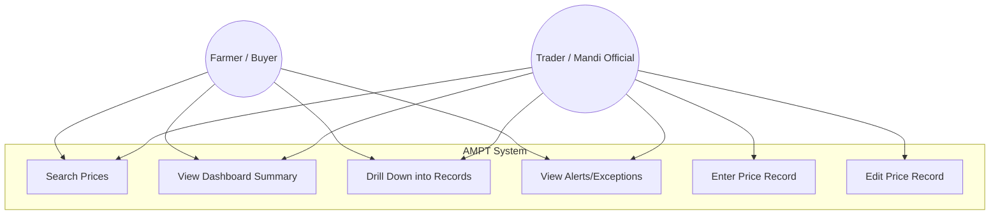
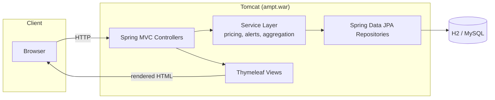
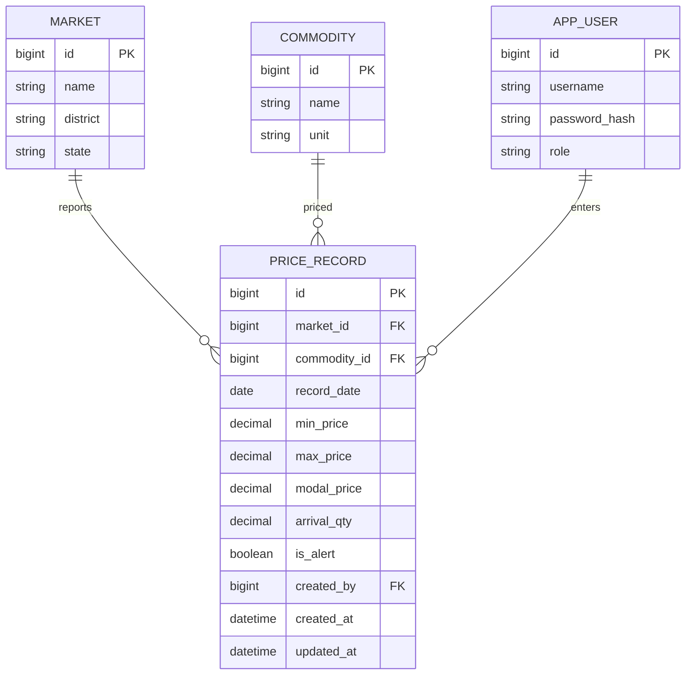

# Task 3 — Requirements, Architecture & Technology Setup
## Agricultural Market Price Tracker (AMPT)

---

## 1. Technology Stack (frozen for this project)

| Layer | Choice | Why |
|---|---|---|
| Language/runtime | Java 21 | LTS, matches local JDK, widely supported by Jenkins/Tomcat tooling |
| Framework | Spring Boot 3.x (Spring MVC + Spring Data JPA) | Fast to scaffold CRUD + REST, standard for Maven/Tomcat DevOps pipelines |
| Build tool | **Maven** | Most common pairing with Jenkins "Maven project" jobs (Task 7); clear `pom.xml` for artifact archiving |
| View layer | Thymeleaf (server-rendered HTML) | Simple dashboard pages without a separate frontend build/deploy step |
| Database | H2 (file-based) for local/dev; MySQL profile for CI/prod-like deploys | H2 needs zero setup for local dev; MySQL is realistic for the Docker/Ansible stages later |
| Deployment target | **Tomcat** (WAR deployment) | App is built as a WAR and dropped into Tomcat's `webapps/`, matching Task 8's explicit Tomcat/Nginx choice |
| Test automation | Selenium WebDriver + JUnit, run via Maven (`mvn test`) | Required by Task 9/10 |
| Container | Docker, Tomcat base image | Required by Task 11/12 |
| Config management | Ansible (chosen over Puppet — agentless, YAML, lower setup cost for a solo/local target node) | Required by Task 13/14 |
| CI/CD orchestrator | Jenkins, Jenkinsfile (pipeline-as-code) | Required by Task 7/8 |

> Nginx is not used as the application server itself; it is noted as an optional
> reverse proxy / TLS terminator in front of Tomcat for the final deployment, but is
> not required for the MVP to function.

---

## 2. Software Requirements Summary (SRS)

### 2.1 Functional Requirements

| ID | Requirement |
|---|---|
| FR1 | System shall allow an authorized user to create a price record for a market/commodity/date |
| FR2 | System shall allow an authorized user to edit an existing price record |
| FR3 | System shall allow any user to search price records by market, commodity, and date range |
| FR4 | System shall display paginated, sortable search results |
| FR5 | System shall compute and display today's average/modal price per commodity |
| FR6 | System shall compute and display % price change vs the previous reporting day |
| FR7 | System shall allow drill-down from a summary indicator to its underlying records |
| FR8 | System shall display full price history for a given market+commodity pair |
| FR9 | System shall flag a record as an alert when its % change exceeds a configurable threshold |
| FR10 | System shall flag a market as an exception when it has not reported by a configured cutoff |
| FR11 | System shall provide a dedicated alerts/exceptions view |

### 2.2 Non-Functional Requirements

| ID | Requirement |
|---|---|
| NFR1 | Dashboard/search responds in < 2s with MVP-scale seed data (local testing) |
| NFR2 | All write endpoints (create/edit) require an authenticated, authorized role |
| NFR3 | Application is packaged as a single deployable WAR artifact |
| NFR4 | Application is container-runnable with no code changes (Task 11/12) |
| NFR5 | Target environment is reproducible from a clean node via Ansible, idempotently (Task 13/14) |
| NFR6 | All critical user journeys are covered by automated Selenium tests gating deployment (Task 9/10) |

---

## 3. Use-Case Diagram



---

## 4. Application Architecture



3-tier, single deployable WAR: **Presentation** (Thymeleaf + MVC controllers) →
**Service** (business rules: aggregation, % change, alert thresholds) →
**Persistence** (Spring Data JPA repositories over H2/MySQL).

---

## 5. Data Model (ER Diagram)



---

## 6. API List

| Method | Endpoint | Purpose | Auth |
|---|---|---|---|
| GET | `/` | Dashboard (summary indicators) | Public |
| GET | `/prices` | Search/list price records (query: market, commodity, from, to, page, sort) | Public |
| GET | `/prices/{id}` | Single record detail (drill-down) | Public |
| POST | `/prices` | Create a price record | Role: ENTRY_USER |
| PUT | `/prices/{id}` | Edit a price record | Role: ENTRY_USER |
| GET | `/dashboard/summary` | JSON: avg/modal price, % change, markets reporting | Public |
| GET | `/alerts` | List active alerts/exceptions | Public |
| GET | `/markets` | List markets (for form dropdowns) | Public |
| GET | `/commodities` | List commodities (for form dropdowns) | Public |
| GET | `/actuator/health` | Health check (used by Ansible/monitoring in Task 14) | Public |

---

## 7. Local Development Setup

See the runnable skeleton committed under `app/` (Task 3 code deliverable) and
`app/README.md` for exact run instructions. Summary:

```bash
cd app
mvn spring-boot:run        # runs with embedded Tomcat + H2, for fast local dev
# or
mvn clean package          # produces target/ampt.war for deployment to a standalone Tomcat
```

Default local profile uses an H2 file database at `./data/amptdb` so data survives
restarts during development; a `mysql` Spring profile is pre-wired for later CI/Docker
stages.

---
*Deliverable status: Task 3 — architecture, data model, API list and local setup
approved as the baseline for Task 4 (GitHub repository initialization).*
