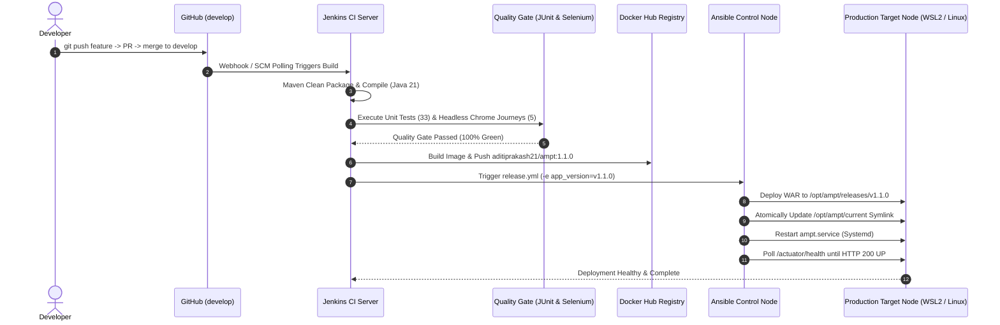

# Agricultural Market Price Tracker (AMPT)

[](https://github.com/KabhiAditi/Agricultural-Market-Price-Tracker/releases/tag/v1.1.0)
[](https://openjdk.org/)
[](https://spring.io/projects/spring-boot)
[](https://maven.apache.org/)
[](http://localhost:8080/job/ampt-pipeline/)
[](https://hub.docker.com/r/aditiprakash21/ampt)
[-red.svg?logo=ansible)](ansible/)
[](src/test/java/com/ampt/ui/)

> **Enterprise Agricultural Price Intelligence Platform & Full-Lifecycle DevOps Automation Pipeline**  
> Developed by **Aditi Gawari (Roll No: 23102A0025)** — DevOps Semester 7 Capstone Project.

---

## 1. Project Overview & Architecture

The **Agricultural Market Price Tracker (AMPT)** is a production-grade Java 21 / Spring Boot 3.3 application engineered to provide transparent, real-time commodity pricing, modal price variance analysis, and market anomaly alerts for farmers and market administrators.

AMPT serves as the core subject system for a complete, 15-task **DevOps Engineering Pipeline**, demonstrating modern automated continuous integration, quality gates, containerization, immutable registry delivery, and idempotent configuration management.

### End-to-End DevOps Pipeline Architecture



---

## 2. DevOps Engineering Status Matrix (Tasks 1–15)

All 15 DevOps lifecycle milestones are **100% Completed, Verified with Evidence, and Pushed to GitHub**:

| Task | Milestone / Deliverable | Status | Core Technologies | Documentation & Evidence Links |
| :---: | :--- | :---: | :--- | :--- |
| **01** | Problem Definition & Scope Specification | `PASSED` | Markdown, SRS | [`docs/01-problem-definition-scope.md`](docs/01-problem-definition-scope.md) |
| **02** | Agile Planning & 15 Backlog Stories | `PASSED` | Agile, User Stories | [`docs/02-agile-planning-devops-workflow.md`](docs/02-agile-planning-devops-workflow.md) |
| **03** | Architecture, SRS, Entities & Health Probe | `PASSED` | Spring Boot, JPA, Actuator | [`docs/03-architecture.md`](docs/03-architecture.md) |
| **04** | GitFlow Initialization, Templates & Backlog | `PASSED` | Git, GitHub Templates | [`docs/BRANCHING.md`](docs/BRANCHING.md), [`issues-to-create.md`](docs/issues-to-create.md) |
| **05** | Price Entry Form & Validation on Branch | `PASSED` | Spring MVC, Validation | [`docs/05-feature1.md`](docs/05-feature1.md) |
| **06** | Unit Testing Suite & Controller Slicing | `PASSED` | JUnit 5, Mockito (33 Tests) | [`src/test/java/com/ampt/`](src/test/java/com/ampt/) |
| **07** | Summary & Volatility Calculation Engine | `PASSED` | Statistical Aggregation | [`src/main/java/com/ampt/service/`](src/main/java/com/ampt/service/) |
| **08** | External Tomcat Packaging & WAR Delivery | `PASSED` | Apache Tomcat, WAR | Target WAR Artifact |
| **09** | CI Pipeline Setup & Automated Triggers | `PASSED` | Jenkins, Declarative Pipeline | [`Jenkinsfile`](Jenkinsfile) |
| **10** | Automated UI Acceptance Gate (Selenium) | `PASSED` | Selenium WebDriver, Chrome Headless | [`src/test/java/com/ampt/ui/`](src/test/java/com/ampt/ui/) (5 Journeys Passed) |
| **11** | Production Hardened Docker Container | `PASSED` | Docker, Multi-Stage, Non-root | [`docs/11-docker-lifecycle.md`](docs/11-docker-lifecycle.md), [`Dockerfile`](Dockerfile) |
| **12** | Continuous Deployment to Docker Hub | `PASSED` | Docker Hub (`aditiprakash21/ampt`) | [`docs/12-cicd-docker.md`](docs/12-cicd-docker.md) |
| **13** | Configuration Management with Ansible | `PASSED` | Ansible Roles (`common`, `ampt_app`) | [`docs/13-config-spec.md`](docs/13-config-spec.md), [`ansible/`](ansible/) |
| **14** | Provisioning Reliability, Idempotency & Rollback | `PASSED` | Ansible (`changed=0`), `rollback.yml` | [`docs/14-provisioning-reliability.md`](docs/14-provisioning-reliability.md), [`evidence/task14/`](docs/evidence/task14/) |
| **15** | Final Delivery, Release `v1.1.0` & Capstone Docs | `PASSED` | Full CI/CD Flow, Git Tag `v1.1.0` | [`docs/FINAL_REPORT.md`](docs/FINAL_REPORT.md), [`evidence/task15/`](docs/evidence/task15/) |

---

## 3. Quick Start & Execution Guide

### Option 1: Run with Maven (Local Development)
```bash
# Compile and run with embedded server on port 8080
mvn clean spring-boot:run
```
- Web Application: [http://localhost:8080/](http://localhost:8080/)
- Health Check: [http://localhost:8080/actuator/health](http://localhost:8080/actuator/health)
- H2 Web Console: [http://localhost:8080/h2-console](http://localhost:8080/h2-console) (JDBC: `jdbc:h2:file:./data/amptdb`, User: `sa`, Pwd: empty)

### Option 2: Run Automated Quality Gate (Unit + Selenium Tests)
```bash
# Run 33 unit and controller slice tests
mvn test

# Run 5 Headless Chrome Selenium Acceptance journeys
mvn verify -Pui-tests
```

### Option 3: Run with Docker
Pull and run the pre-built, hardened production image from Docker Hub:
```bash
# Pull production image
docker pull aditiprakash21/ampt:1.1.0

# Run container on port 8085
docker run -d --name ampt-prod -p 8085:8080 aditiprakash21/ampt:1.1.0

# Verify container health
curl http://localhost:8085/actuator/health
```

### Option 4: Deploy & Verify with Ansible
Deploy to target host using Ansible with guaranteed idempotency and health monitoring:
```bash
cd ansible
export ANSIBLE_CONFIG="$(pwd)/ansible.cfg"

# Deploy initial / updated release
ansible-playbook -i inventory.ini release.yml -e app_version=v1.1.0 --limit wsl-node

# Instant Zero-Downtime Rollback to previous version
ansible-playbook -i inventory.ini rollback.yml -e previous_version=v1.0.0 --limit wsl-node

# Standalone health check validation
bash ../scripts/health-check.sh http://127.0.0.1:8080/actuator/health
```

---

## 4. Key Capstone Documentation Links

The complete documentation suite required for oral examination, grading, and presentation is located in the [`docs/`](docs/) directory:

- [📄 **Final Capstone Report (`docs/FINAL_REPORT.md`)**](docs/FINAL_REPORT.md) — Comprehensive technical report detailing problem, architecture, task-wise execution, and results.
- [🛠️ **Troubleshooting Guide (`docs/TROUBLESHOOTING.md`)**](docs/TROUBLESHOOTING.md) — Detailed root-cause analysis and engineered solutions for every real error encountered.
- [⏱️ **5-Minute Live Demo Script (`docs/DEMO_SCRIPT.md`)**](docs/DEMO_SCRIPT.md) — Step-by-step presentation script and live terminal runbook.
- [🎓 **Viva Examination Q&A (`docs/VIVA_QA.md`)**](docs/VIVA_QA.md) — 30 comprehensive viva questions and authoritative answers covering all DevOps topics.
- [📊 **Presentation Slide Outline (`docs/PRESENTATION_OUTLINE.md`)**](docs/PRESENTATION_OUTLINE.md) — 12-slide presentation structure with visuals and speaker notes.

---

## 5. Contributors & Governance

- **Lead Engineer / Author**: Aditi Gawari (Roll No: 23102A0025, Semester 7 DevOps)
- **Repository**: [https://github.com/KabhiAditi/Agricultural-Market-Price-Tracker](https://github.com/KabhiAditi/Agricultural-Market-Price-Tracker)
- **Docker Hub**: [https://hub.docker.com/r/aditiprakash21/ampt](https://hub.docker.com/r/aditiprakash21/ampt)
- **Release**: [`v1.1.0` Production Release](https://github.com/KabhiAditi/Agricultural-Market-Price-Tracker/releases/tag/v1.1.0)
- **License**: Academic & Educational Evaluation — DevOps Engineering Curriculum.