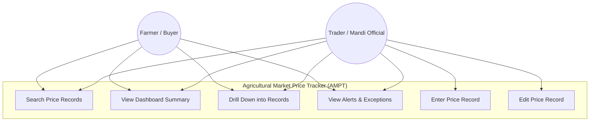
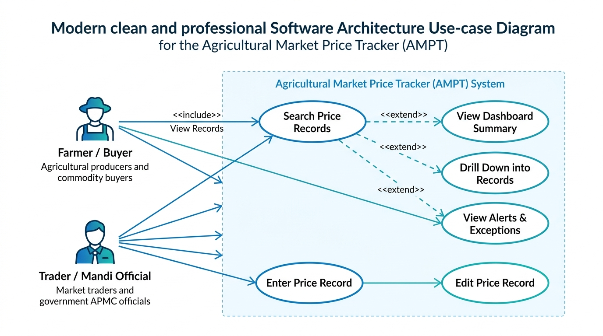
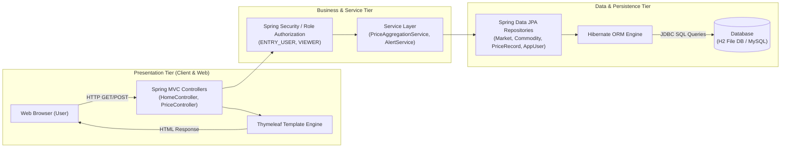
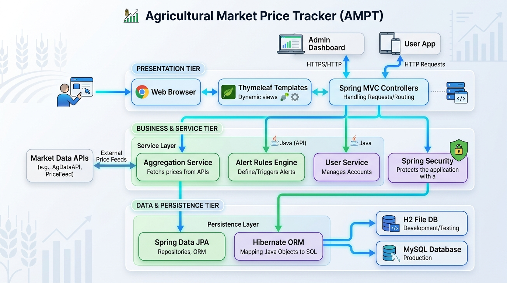
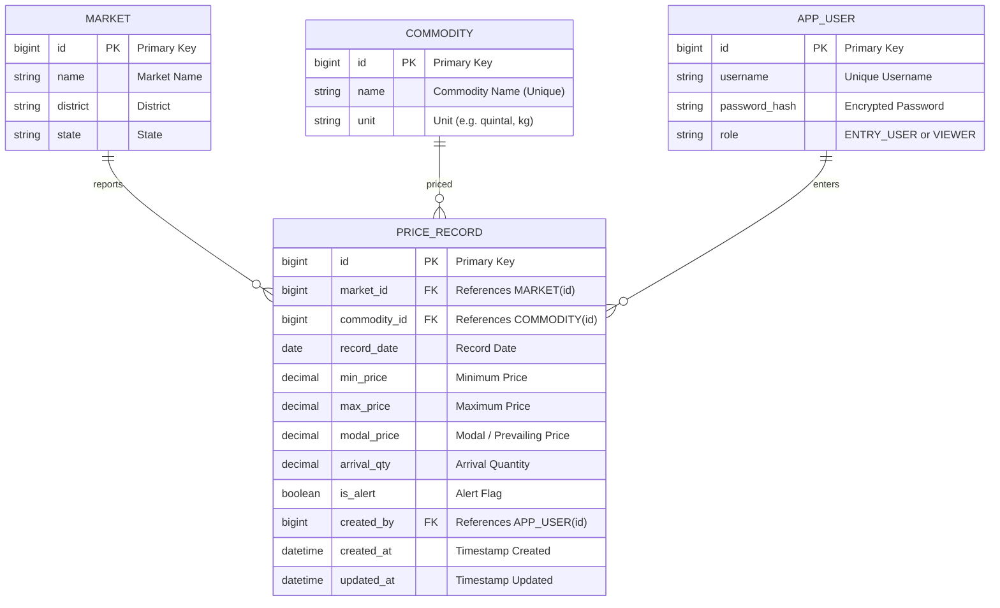
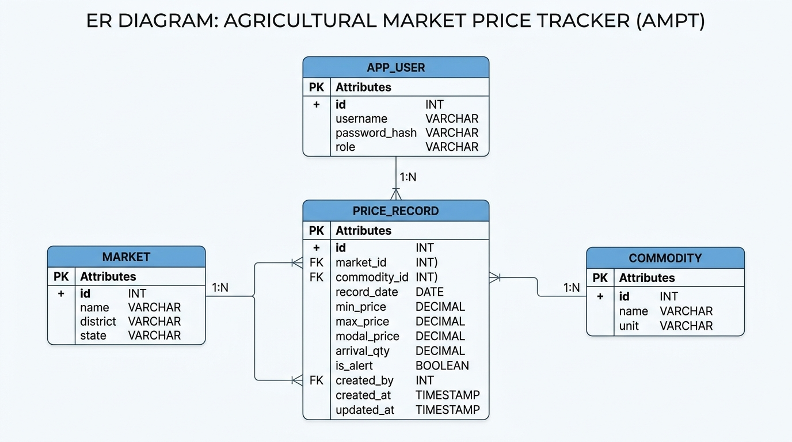

# Task 3 — Requirements, Architecture & Technology Setup
## Agricultural Market Price Tracker (AMPT)

---

## 1. Technology Stack & Local Environment Setup

| Layer | Component / Tool | Version / Details | Rationale |
|---|---|---|---|
| **Language / Runtime** | Java | OpenJDK 21 (LTS) | Long-term support, standard enterprise baseline, compatible with Spring Boot 3.3.x. |
| **Backend Framework** | Spring Boot | 3.3.4 (Spring MVC, Spring Data JPA, Actuator) | Rapid scaffolding for robust REST and MVC endpoints, declarative persistence. |
| **Build & Dependency Tool** | Apache Maven | 3.9+ | Standard dependency resolution, JUnit test execution, and WAR packaging for Jenkins pipelines. |
| **View / UI Layer** | Thymeleaf | Embedded in Spring Boot | Server-rendered dynamic HTML templates without overhead of a standalone frontend pipeline. |
| **Primary Database (Local)** | H2 Database | Embedded File-based (`./data/amptdb`) | Zero configuration required for rapid local iteration; persists records across restarts. |
| **Production Database (Profile)** | MySQL | Profile `mysql` | Realistic relational target used in Docker, Kubernetes, and Ansible automation stages. |
| **Application Server** | Apache Tomcat | 10.1 (WAR packaging + embedded runner) | Dual deployment mode: standalone (`mvn spring-boot:run`) or WAR dropped into Tomcat `webapps/`. |
| **Continuous Integration** | Jenkins | Pipelines-as-code (`Jenkinsfile`) | Automated build, test, static analysis, and deployment orchestration. |
| **Configuration Management** | Ansible | YAML Playbooks (Docker/WSL2 execution) | Agentless idempotent provisioning and server configuration. |
| **Test Automation** | JUnit 5 + Selenium WebDriver | 4.25.0 | Unit, integration, and automated end-to-end browser regression testing. |

---

## 2. Software Requirements Specification (SRS) Summary

### 2.1 Functional Requirements

| ID | Requirement Name | Description |
|---|---|---|
| **FR1** | Create Price Record | System shall permit authorized users (`ENTRY_USER`) to record commodity prices for a specific market and date. |
| **FR2** | Edit Price Record | System shall permit authorized users (`ENTRY_USER`) to modify previously submitted price records. |
| **FR3** | Search Price Records | System shall permit users to query price records filtering by Market, Commodity, and Date Range. |
| **FR4** | Paginated & Sorted Results | System shall display query results with configurable page size and sorting (e.g., date descending). |
| **FR5** | Summary Indicators | System shall compute and display daily modal and average prices per commodity across reporting markets. |
| **FR6** | Price Change Calculation | System shall compute percentage change in modal price relative to the previous trading session. |
| **FR7** | Indicator Drill-Down | System shall enable clicking any summary metric to view underlying constituent market records. |
| **FR8** | Price History View | System shall present chronological historical price trends for specific Market + Commodity pairs. |
| **FR9** | Price Volatility Alerts | System shall flag price records exceeding configurable volatility thresholds (`is_alert = true`). |
| **FR10** | Missing Data Exceptions | System shall detect and flag markets failing to report daily prices before the cutoff window. |
| **FR11** | Dedicated Alerts View | System shall provide a centralized dashboard displaying active alerts and missing reporting exceptions. |

### 2.2 Non-Functional Requirements

| ID | Category | Requirement Description |
|---|---|---|
| **NFR1** | Performance | Search queries and dashboard aggregations shall render in under 2 seconds for seed and standard operational datasets. |
| **NFR2** | Security & RBAC | Write endpoints (`POST`, `PUT`) require role-based authorization (`ENTRY_USER`); dashboard search is public (`VIEWER`). |
| **NFR3** | Portability & Packaging | Packaged as a standard standalone-executable WAR deployable directly to external Apache Tomcat servers. |
| **NFR4** | Container Readiness | Dockerizable via standard multi-stage Dockerfile without source modifications. |
| **NFR5** | Idempotence | Infrastructure setup must be fully automated and repeatable via Ansible playbooks. |
| **NFR6** | Quality & Test Coverage | Continuous automated testing via JUnit and Selenium gates all pipeline deployments. |

---

## 3. Use-Case Diagram





---

## 4. 3-Tier Application Architecture





### Tier Responsibilities
1. **Presentation Tier**: Handles client HTTP requests, form submissions, and delivers server-rendered Thymeleaf HTML pages and JSON payloads.
2. **Business & Service Tier**: Enforces business logic, calculates percentage changes, evaluates alert thresholds, and manages user authentication/authorization.
3. **Data & Persistence Tier**: Utilizes Spring Data JPA and Hibernate ORM over an embedded H2 file database (`./data/amptdb`) for development or MySQL for staging/production.

---

## 5. Entity Relationship (ER) Diagram





---

## 6. Application API & Route Specifications

| HTTP Method | Route / Endpoint | Description | Query / Body Parameters | Authorization |
|---|---|---|---|---|
| **GET** | `/` | Main Dashboard view (seeded metrics, summary) | None | Public (`VIEWER`) |
| **GET** | `/prices` | Search and filter market price records | `marketId`, `commodityId`, `from`, `to`, `page`, `sort` | Public (`VIEWER`) |
| **GET** | `/prices/{id}` | Drill-down view for a specific price record | `id` (path parameter) | Public (`VIEWER`) |
| **GET** | `/prices/new` | Render price entry form | None | Role: `ENTRY_USER` |
| **POST** | `/prices` | Submit new price record | `marketId`, `commodityId`, `minPrice`, `maxPrice`, `modalPrice`, `arrivalQty`, `recordDate` | Role: `ENTRY_USER` |
| **GET** | `/prices/{id}/edit` | Render price edit form | `id` (path parameter) | Role: `ENTRY_USER` |
| **POST** | `/prices/{id}` | Update existing price record | Price update fields | Role: `ENTRY_USER` |
| **GET** | `/alerts` | Dedicated view for threshold alerts & missing reports | `threshold` (optional) | Public (`VIEWER`) |
| **GET** | `/actuator/health` | Spring Boot health check for monitoring / CI | None | Public (`VIEWER`) |

---

## 7. Local Execution & Verification

### Build Command
```bash
mvn clean package
```
- Compiles 11 Java source files with JDK 21.
- Executes automated test suite (`AmptApplicationTests`).
- Assembles repackaged, executable WAR artifact at `target/ampt.war`.

### Run Standalone Local Server
```bash
mvn spring-boot:run
```
- Boots embedded Apache Tomcat on port `8082` (configured to avoid conflict with Jenkins on port `8080` and Tomcat on port `8081`).
- Mounts H2 file database at `./data/amptdb` and applies initial schema seed (`src/main/resources/data.sql`).

### Live URLs
- **Dashboard**: [http://localhost:8082/](http://localhost:8082/)
- **Actuator Health**: [http://localhost:8082/actuator/health](http://localhost:8082/actuator/health)
- **H2 Database Console**: [http://localhost:8082/h2-console](http://localhost:8082/h2-console) (JDBC URL: `jdbc:h2:file:./data/amptdb`, User: `sa`, Password: empty)
