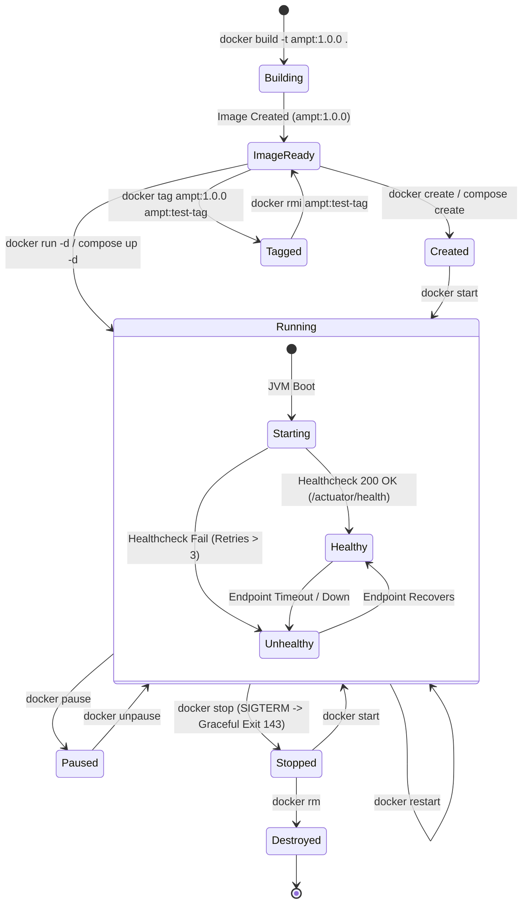

# Task 11: Docker Image and Container Lifecycle

## Overview
This document details the containerization of the **Agricultural Market Price Tracker (AMPT)** application using a multi-stage Docker build, production security best practices, and Docker Compose orchestration with MySQL 8.0.

---

## 1. Multi-Stage Dockerfile Architecture

The application is containerized using a two-stage [Dockerfile](../Dockerfile):

```dockerfile
# Stage 1: Build stage
FROM maven:3.9-eclipse-temurin-21 AS builder
WORKDIR /build
COPY pom.xml .
RUN mvn dependency:go-offline -B
COPY src ./src
RUN mvn clean package -DskipTests -B

# Stage 2: Runtime stage
FROM eclipse-temurin:21-jre
LABEL maintainer="AMPT DevOps Team" version="1.0.0"
RUN apt-get update && apt-get install -y --no-install-recommends curl && rm -rf /var/lib/apt/lists/*
RUN groupadd -r amptgroup && useradd -r -g amptgroup -m -d /home/amptuser amptuser
WORKDIR /app
COPY --from=builder /build/target/ampt.war /app/app.war
RUN mkdir -p /app/data && chown -R amptuser:amptgroup /app
USER amptuser:amptgroup
EXPOSE 8080
ENV SERVER_PORT=8080 SPRING_PROFILES_ACTIVE=local JAVA_OPTS="-Xms256m -Xmx512m -XX:+UseG1GC"
HEALTHCHECK --interval=30s --timeout=5s --start-period=30s --retries=3 \
    CMD curl -f http://localhost:8080/actuator/health || exit 1
ENTRYPOINT ["sh", "-c", "exec java $JAVA_OPTS -jar /app/app.war"]
```

### Packaging Decision & Rationale: `eclipse-temurin:21-jre` vs `tomcat:10.1`

We selected **`eclipse-temurin:21-jre`** with Spring Boot executable packaging over an external Tomcat container.

| Evaluation Criterion | `eclipse-temurin:21-jre` (Selected) | `tomcat:10.1-jre21` |
|---|---|---|
| **Architectural Model** | 12-Factor App (Self-contained executable) | Traditional Application Server host |
| **Image Size & Attack Surface** | Minimal JRE base layer (~219MB content size); no unused servlet container tools | Larger footprint with default Tomcat managers, webapps, docs, and configs |
| **Process & Signal Handling** | `java -jar` directly receives Unix signals (`SIGTERM`, `SIGINT`) allowing graceful shutdown | Signals pass through Tomcat catalina wrapper scripts |
| **Context Path Parity** | Standard `/` root deployment without WAR renaming hacks | Requires deploying WAR as `ROOT.war` or configuring context XMLs |
| **Configuration Complexity** | Zero external servlet configuration; 100% configured via Spring `application.yml` and ENV | Requires synchronizing `server.xml`, `context.xml`, and JVM properties |

---

## 2. Docker Container Lifecycle Diagram

The following Mermaid state diagram illustrates the complete container lifecycle demonstrated in Task 11:



---

## 3. Multi-Container Orchestration: Docker Compose

The [docker-compose.yml](../docker-compose.yml) orchestrates both the AMPT application service and a backing MySQL 8.0 database service:

- **MySQL Service (`ampt-mysql`)**:
  - Image: `mysql:8.0.36`
  - Healthcheck: `mysqladmin ping -h localhost -u ampt -pamptpassword`
  - Persistence: Dedicated named volume `ampt_mysql_data`
- **Application Service (`ampt-app`)**:
  - Builds from local `Dockerfile`
  - `depends_on`: Waits for `mysql` condition `service_healthy`
  - Profile: `SPRING_PROFILES_ACTIVE=mysql`
  - Dynamic JDBC Connection: `jdbc:mysql://mysql:3306/amptdb`
  - Healthcheck: Probes `http://localhost:8080/actuator/health`

---

## 4. Verification and Command Execution Summary

All commands were executed and their actual console outputs captured in [`docker/command-log.txt`](../docker/command-log.txt):

1. **`docker build -t ampt:1.0.0 .`**: Completed successfully with 20/20 build steps.
2. **`docker images`**: Confirmed creation of `ampt:1.0.0` (219 MB content size).
3. **`docker run -d --name ampt -p 8085:8080 ampt:1.0.0`**: Started detached container.
4. **`docker ps`**: Verified container status transitioned from `health: starting` to `healthy`.
5. **`docker logs ampt`**: Verified Spring Boot 3.3.4 boot sequence, HikariCP pool startup, and sample data seeding.
6. **`docker exec`**: Confirmed execution under non-root user `amptuser` (UID 999) and local actuator check.
7. **`docker inspect ampt`**: Verified ports, volume isolation, and healthcheck probe status.
8. **`docker stop / start / restart / rm`**: Successfully executed graceful shutdown (exit code 143), restart, and deletion.
9. **`docker tag / rmi`**: Tested image tagging and untagging.
10. **`docker compose up -d / ps / down`**: Full multi-tier stack orchestrated with automated service dependency sequencing and healthy status on port `8085`.
