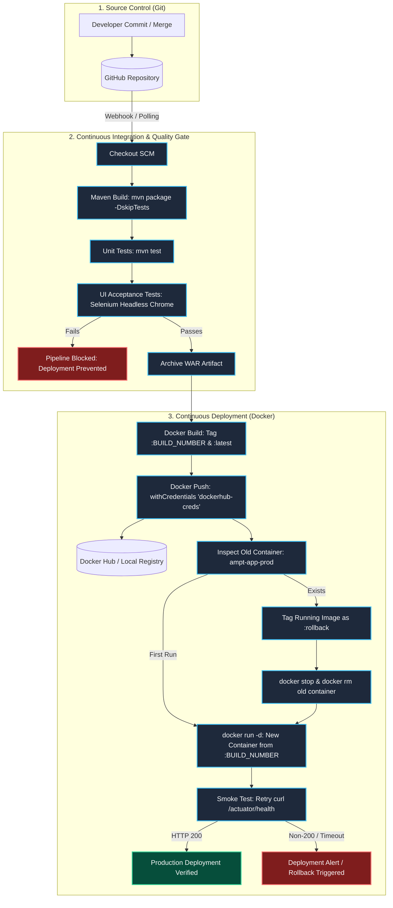

# Task 12: Continuous Deployment to Docker (Jenkins to Docker CD)

## Overview
This document details the Continuous Deployment (CD) pipeline implementation for the **Agricultural Market Price Tracker (AMPT)** application. The Jenkins pipeline is extended from CI and Quality Gates into full Continuous Deployment: building versioned Docker images, pushing to Docker Hub (or a local registry), orchestrating zero-downtime container replacement on Windows, safe rollback preservation, and post-deployment smoke testing.

---

## 1. End-to-End CI/CD Flow: Commit to Container



---

## 2. Pipeline Stages in `Jenkinsfile`

The updated [`Jenkinsfile`](../Jenkinsfile) introduces the following CD stages:

1. **Docker Build**:
   - Builds image using the multi-stage `Dockerfile`:
     ```bash
     docker build -t <dockerhub-user>/ampt:${BUILD_NUMBER} -t <dockerhub-user>/ampt:latest .
     ```
2. **Docker Push**:
   - Securely injects credentials using Jenkins `withCredentials`:
     ```groovy
     withCredentials([usernamePassword(credentialsId: 'dockerhub-creds', usernameVariable: 'DH_USER', passwordVariable: 'DH_TOKEN')]) {
         bat """
             echo %DH_TOKEN% | docker login -u %DH_USER% --password-stdin
             docker push <dockerhub-user>/ampt:${BUILD_NUMBER}
             docker push <dockerhub-user>/ampt:latest
         """
     }
     ```
3. **Deploy Container**:
   - **Rollback Safety**: Checks if `ampt-app-prod` is already running. If so, tags its current image as `<dockerhub-user>/ampt:rollback` before stopping and removing it.
   - Deploys the freshly built image:
     ```bash
     docker run -d --name ampt-app-prod -p 8085:8080 -e SPRING_PROFILES_ACTIVE=dev -e SERVER_PORT=8080 --restart unless-stopped <dockerhub-user>/ampt:${BUILD_NUMBER}
     ```
4. **Smoke Test**:
   - Polls `http://localhost:8085/actuator/health` with retry logic (up to 12 retries with 5s intervals).
   - Validates that HTTP status is `200` and actuator reports `{"status":"UP"}`.

---

## 3. Configuring Jenkins for Docker on Windows

### Step A: Configure Docker Hub Credentials in Jenkins
1. Open Jenkins at `http://localhost:8080`.
2. Go to **Manage Jenkins** > **Credentials** > **System** > **Global credentials (unrestricted)**.
3. Click **Add Credentials**:
   - **Kind**: `Username with password`
   - **Scope**: `Global`
   - **Username**: Your Docker Hub username (e.g. `aditiprakash21`)
   - **Password**: Your Docker Hub Personal Access Token (PAT) (generate under Docker Hub *Account Settings > Security > New Access Token*)
   - **ID**: `dockerhub-creds` *(must match the `credentialsId` in Jenkinsfile)*
   - **Description**: `Docker Hub Credentials for AMPT CD`
4. Click **Create**.

### Step B: Grant Jenkins Access to Docker Desktop on Windows
Jenkins runs as a Windows Service (`Local System` or specific user) by default. To allow Jenkins to execute `docker` commands:
1. **Ensure Docker CLI is in System PATH**:
   - Confirm `C:\Program Files\Docker\Docker\resources\bin` and `C:\ProgramData\DockerDesktop\version-bin` are in the **System** Environment Variables `PATH`.
2. **Expose Docker Daemon on Windows Named Pipe**:
   - In Docker Desktop, open **Settings (gear icon)** > **General**.
   - Ensure **Use the WSL 2 based engine** is checked.
   - In **Advanced**, ensure **Allow access to the Docker Desktop CLI from Windows** is enabled.
3. **Add Jenkins Service User to `docker-users` Group**:
   - Open PowerShell as Administrator:
     ```powershell
     net localgroup docker-users
     net localgroup docker-users "NT AUTHORITY\SYSTEM" /add
     # If Jenkins runs as a specific local account (e.g. your Windows user):
     net localgroup docker-users "$env:USERNAME" /add
     ```
   - Restart Jenkins Windows service:
     ```powershell
     Restart-Service jenkins
     ```

---

## 4. Local Registry Alternative (`registry:2` on port 5000)

If you prefer deploying locally without Docker Hub credentials or external network latency:

1. **Start the local Docker registry container**:
   ```powershell
   docker run -d -p 5000:5000 --restart always --name local-registry registry:2
   ```
2. **Pipeline Parameter Adjustment**:
   - In Jenkins, click **Build with Parameters**.
   - Set `DOCKERHUB_USER`: `localhost:5000`
   - Set `IMAGE_NAME`: `ampt`
3. **Pushing to Local Registry**:
   - The pipeline will tag images as `localhost:5000/ampt:${BUILD_NUMBER}` and `localhost:5000/ampt:latest`.
   - No login required; it pushes directly to `localhost:5000`.
4. **Inspect Registry Catalog**:
   ```powershell
   curl.exe http://localhost:5000/v2/_catalog
   # Output: {"repositories":["ampt"]}
   curl.exe http://localhost:5000/v2/ampt/tags/list
   # Output: {"name":"ampt","tags":["1","latest"]}
   ```

---

## 5. Evidence Checklist & Screenshots Guide

For your assignment report/evidence submission, capture the following 3 screenshots:

| # | Evidence Item | Description & What to Display |
|---|---|---|
| **1** | **Jenkins Pipeline Run** | Screenshot of the Jenkins Pipeline stage view showing all green stages: `Checkout` ➔ `Build` ➔ `Unit & UI Tests` ➔ `Package` ➔ `Docker Build` ➔ `Docker Push` ➔ `Deploy Container` ➔ `Smoke Test`. |
| **2** | **Docker Hub Tags Page** | Screenshot of your Docker Hub repository (`https://hub.docker.com/r/<user>/ampt/tags`) showing the versioned tag (`:${BUILD_NUMBER}`) and the `:latest` tag pushed with matching digests. *(Or local registry API curl output if using `registry:2`)*. |
| **3** | **`docker ps` in Terminal** | PowerShell terminal screenshot running: <br>`docker ps`<br>showing `ampt-app-prod` with status `Up ... (healthy)` and port mapped `0.0.0.0:8085->8080/tcp`, alongside `curl.exe http://localhost:8085/actuator/health` returning `{"status":"UP"}`. |
