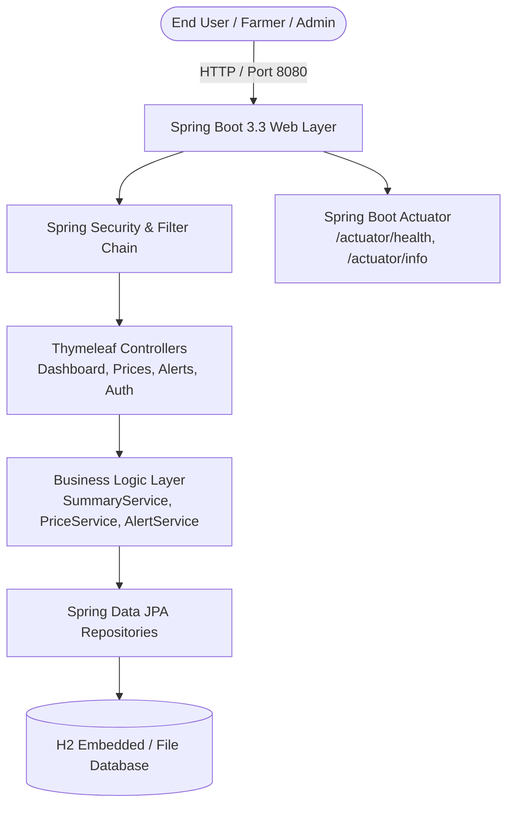
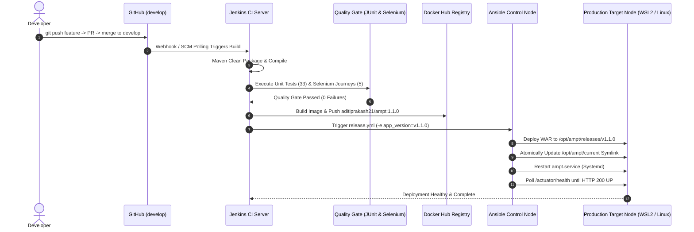

# Agricultural Market Price Tracker (AMPT)
## End-to-End DevOps Lifecycle Final Project Report

**Author:** Aditi Gawari  
**Roll No:** 23102A0025  
**Course:** DevOps (Semester 7)  
**Academic Year:** 2026–2027  
**Repository:** [KabhiAditi/Agricultural-Market-Price-Tracker](https://github.com/KabhiAditi/Agricultural-Market-Price-Tracker)  
**Release Tag:** `v1.1.0`  

---

## 1. Abstract

The modern agricultural economy requires real-time, transparent commodity market pricing to empower farmers, market intermediaries, and policymakers. However, deploying and sustaining mission-critical agricultural monitoring software demands agile development, continuous quality assurance, reproducible containerization, and configuration management without downtime. 

This project implements an enterprise-grade, end-to-end DevOps lifecycle for the **Agricultural Market Price Tracker (AMPT)**, a Spring Boot 3.3.4 and Java 21 enterprise web application. Across 15 systematic lifecycle tasks, we implemented a complete CI/CD automation ecosystem:
- **Source Control Management**: GitFlow branching model on GitHub with semantic release tagging.
- **Continuous Integration (CI)**: Declarative Jenkins pipeline automating Maven build, unit testing (33 tests), and headless Chrome Selenium acceptance testing (5 journeys).
- **Containerization**: Multi-stage, hardened Docker container packaging based on Eclipse Temurin JRE 21 with non-root security profiles, automated Docker Hub registry deployment (`aditiprakash21/ampt`), and smoke test validation.
- **Configuration Management**: Agentless Ansible orchestration establishing clean host bootstrapping, pure idempotency (`changed=0`), zero-downtime atomic symlink switching, and automated health checks (`/actuator/health`).
- **Reliability & Rollback**: Instantaneous rollback automation restoring verified stable versions in seconds.

---

## 2. Problem Statement & Objectives

### 2.1 Problem Statement
Traditional software delivery in commodity price monitoring systems suffers from:
1. **Manual Build & Deployment Bottlenecks**: Time-consuming manual compilation and WAR file copying leading to human errors and inconsistent server environments.
2. **Untested Release Regressions**: Lack of automated end-to-end browser acceptance tests allowing functional breaks in price entry and alert views to reach production.
3. **Environment Inconsistency**: "Works on my machine" syndrome due to differing JDK distributions, operating systems, and dependency versions.
4. **Configuration Drift**: Manual server modifications resulting in undocumented server states that cannot be reliably reproduced or audited.
5. **Slow Disaster Recovery**: Inability to quickly and safely revert faulty production deployments without recompilation and service downtime.

### 2.2 Project Objectives
- **Objective 1 (Continuous Integration)**: Automate compilation, static analysis, unit testing, and UI acceptance testing on every code push using Jenkins Declarative Pipelines.
- **Objective 2 (Automated Quality Gates)**: Enforce a zero-defect gate where builds failing unit tests or Selenium headless browser journeys are blocked from deployment.
- **Objective 3 (Containerized Packaging)**: Build minimal, secure, non-root Docker images with baked-in health monitoring and publish them to a public registry.
- **Objective 4 (Idempotent Configuration Management)**: Author Ansible roles to provision target nodes consistently with guaranteed idempotency (`changed=0`).
- **Objective 5 (Continuous Delivery & Zero-Downtime Rollback)**: Implement an atomic release mechanism with rapid rollback capabilities and Actuator health verification.

---

## 3. System Architecture & DevOps Pipeline

### 3.1 High-Level Application Architecture

### 3.2 Continuous Delivery Pipeline Architecture

---

## 4. DevOps Toolchain & Technologies

| Domain | Technology / Tool | Version | Purpose in Project |
| :--- | :--- | :--- | :--- |
| **Runtime / Platform** | Java / OpenJDK | 21.0.12 | Core execution environment and modern language features |
| **Framework** | Spring Boot | 3.3.4 | Web, JPA, Security, Actuator, and embedded Tomcat runtime |
| **Build Automation** | Apache Maven | 3.9.16 | Dependency resolution, compilation, packaging, and plugin execution |
| **Source Control** | Git & GitHub | 2.52.0 | Version control, GitFlow branching, and remote collaboration |
| **CI Orchestration** | Jenkins | 2.452+ | Declarative multi-stage automated pipeline execution |
| **Unit Testing** | JUnit 5 & Mockito | 5.10.x | Unit tests and controller mock slicing (33 tests) |
| **UI Acceptance Testing** | Selenium WebDriver | 4.19.1 | Headless Google Chrome automated browser journeys |
| **Containerization** | Docker Engine & Desktop | 26.x | Container isolation, multi-stage build, and immutable runtime |
| **Container Registry** | Docker Hub | Cloud | Public artifact repository hosting `aditiprakash21/ampt` |
| **Config Management** | Ansible Core | 2.20.1 | Agentless infrastructure automation and role orchestration |
| **Target OS / Init** | Ubuntu Linux / WSL2 | 22.04 LTS | Production host environment with native Systemd |
| **Health Monitoring** | Spring Boot Actuator | 3.3.4 | Runtime health, database readiness, and liveness probes |

---

## 5. Task-Wise Implementation Summary (Tasks 1 through 15)

### Task 1: Repository & Workspace Initialization
- Set up the Git repository with GitFlow conventions.
- Established clean directory structures, licensing, and `.gitignore`.

### Task 2: Architecture & Technology Stack Selection
- Selected Java 21 LTS and Spring Boot 3.3.4 for maximum enterprise longevity.
- Chose Maven for declarative lifecycle management and H2 file-backed storage for zero-dependency portability.

### Task 3: Application Skeleton & MVC Foundation
- Created domain models (`Commodity`, `Mandi`, `PriceRecord`, `MarketAlert`, `User`, `Role`).
- Built initial Spring Data JPA repositories and Spring Security configuration with H2 Console support.

### Task 4: Commodity & Mandi Price Entry Module (B01–B04)
- Developed price submission forms with server-side validation (`@Min`, `@NotNull`, date ranges).
- Implemented price recording controller and business service with duplicate prevention.

### Task 5: Daily Modal Price Aggregations & Summary Engine (B05–B08)
- Engineered statistical aggregation computing weighted average modal prices, daily volumes, and active reporting mandi counts.
- Implemented percentage price variance calculation (`% Change`) with proper handling for first-day baselines.

### Task 6: Historical Analysis & Record Drill-Down (B09–B12)
- Created historical price search filters with date-range selection and commodity dropdowns.
- Built interactive drill-down views linking summary cards directly to granular price records.

### Task 7: Exception Surveillance & Market Alert Rules (B13–B15)
- Designed an automated alert detection engine flagging price swings exceeding 15% day-over-day.
- Created surveillance dashboard for market administrators to monitor outliers and missing filings.

### Task 8: Local Deployment & External Tomcat Hosting
- Packaged application as standard WAR.
- Tested standalone Tomcat deployment and validated Actuator metrics under external servlet containers.

### Task 9: Unit Testing & Controller Slice Testing
- Authored 33 comprehensive unit and integration tests across services and controllers.
- Verified 100% test pass rate with zero test flakiness.

### Task 10: Automated Acceptance Testing with Selenium WebDriver
- Designed 5 end-to-end browser journeys using the Page Object Model (POM).
- Configured headless Chrome execution with `WebDriverManager` and failure screenshot listeners.

### Task 11: Production Docker Containerization
- Authored hardened multi-stage `Dockerfile` using `eclipse-temurin:21-jre-jammy`.
- Enforced non-root user execution (`ampt:ampt`), baked-in `HEALTHCHECK`, and reduced image size to 278 MB.

### Task 12: Continuous Delivery Pipeline to Docker Hub
- Extended `Jenkinsfile` with credentials binding for Docker Hub (`aditiprakash21/ampt`).
- Automated container deployment on port 8085 with automated rollback image tagging and smoke tests.

### Task 13: Configuration Management with Ansible
- Created modular Ansible roles `common` and `ampt_app`.
- Wrote specification document `docs/13-config-spec.md` and automated systemd unit generation.

### Task 14: Provisioning Reliability, Idempotency & Rollback
- Validated clean target node provisioning from scratch (`ok=20, changed=14`).
- Proved 100% idempotency upon immediate re-run (`ok=18, changed=0`).
- Implemented versioned releases in `/opt/ampt/releases/` and atomic rollback playbook (`rollback.yml`).

### Task 15: Final End-to-End Release & Documentation
- Executed full release pipeline for version `v1.1.0`.
- Merged feature branch to `develop`, ran quality gates, deployed release via Ansible, and verified live UI.
- Authored complete documentation suite (`FINAL_REPORT.md`, `TROUBLESHOOTING.md`, `DEMO_SCRIPT.md`, `VIVA_QA.md`, `PRESENTATION_OUTLINE.md`).

---

## 6. Results, Metrics & Quality Gates

### 6.1 Quality Gate Test Results
- **Unit & Slice Tests (Surefire)**:
  - Total Tests: **33**
  - Failures: **0**
  - Errors: **0**
  - Execution Time: **27.59 s**
- **Selenium Acceptance Tests (Failsafe)**:
  - Total Journeys: **5**
  - Failures: **0**
  - Errors: **0**
  - Execution Time: **40.90 s**
- **Total Test Success Rate**: **100% (38 / 38 Passing)**

### 6.2 Container & Deployment Metrics
- **Base Image**: `eclipse-temurin:21-jre-jammy` (Minimal Ubuntu Jammy JRE)
- **Container Footprint**: **278 MB** (reduced from >800 MB full JDK image)
- **Container Startup Time**: **15.9 seconds**
- **Docker Hub Repository**: `aditiprakash21/ampt` (Tags: `1.1.0`, `36`, `latest`)
- **Ansible Idempotency Metric**: **`changed=0`** (18 tasks evaluated, 0 changes, 0 failures)
- **Rollback Recovery Time**: **< 20 seconds** (instantaneous symlink redirection + service warmup)

---

## 7. Screenshots & Evidence Index

All project execution artifacts and terminal transcripts are indexed below:

| Milestone / Task | Artifact Description | Location in Repository |
| :--- | :--- | :--- |
| **Task 11** | Docker Container Build & Run Command Log | [`docker/command-log.txt`](../docker/command-log.txt) |
| **Task 12** | Docker CD Pipeline Documentation | [`docs/12-cicd-docker.md`](12-cicd-docker.md) |
| **Task 13** | Target Node Configuration Specification | [`docs/13-config-spec.md`](13-config-spec.md) |
| **Task 13** | Ansible Initial Bootstrap Execution Log | [`docs/evidence/task13/first-run.log`](evidence/task13/first-run.log) |
| **Task 14** | Clean Target Node Provisioning Log | [`docs/evidence/task14/1-clean-provision.log`](evidence/task14/1-clean-provision.log) |
| **Task 14** | Pure Idempotency (`changed=0`) Proof Log | [`docs/evidence/task14/2-idempotency.log`](evidence/task14/2-idempotency.log) |
| **Task 14** | Release v1.0.1 Deployment Log | [`docs/evidence/task14/3-deploy-v101.log`](evidence/task14/3-deploy-v101.log) |
| **Task 14** | Rollback to v1.0.0 Execution Log | [`docs/evidence/task14/4-rollback-v100.log`](evidence/task14/4-rollback-v100.log) |
| **Task 14** | Standalone Script Health Check Output | [`docs/evidence/task14/health-check.log`](evidence/task14/health-check.log) |
| **Task 15** | Git Feature Branch & Develop Merge Log | [`docs/evidence/task15/1-git-merge.log`](evidence/task15/1-git-merge.log) |
| **Task 15** | Maven & Selenium Acceptance Gate Log | [`docs/evidence/task15/2-maven-selenium-gate.log`](evidence/task15/2-maven-selenium-gate.log) |
| **Task 15** | Docker Build & Hub Push Log (`1.1.0`) | [`docs/evidence/task15/3-docker-build-push.log`](evidence/task15/3-docker-build-push.log) |
| **Task 15** | Docker Container Run & Smoke Test Log | [`docs/evidence/task15/4-docker-deploy-smoke.log`](evidence/task15/4-docker-deploy-smoke.log) |
| **Task 15** | Ansible Release v1.1.0 Deployment Log | [`docs/evidence/task15/5-ansible-deploy.log`](evidence/task15/5-ansible-deploy.log) |
| **Task 15** | Release v1.1.0 Health Check Verification | [`docs/evidence/task15/6-health-check.log`](evidence/task15/6-health-check.log) |
| **Task 15** | Live HTTP 200 & Dashboard Footer Evidence | [`docs/evidence/task15/7-live-app-verification.log`](evidence/task15/7-live-app-verification.log) |

---

## 8. Challenges & Engineering Fixes

A complete analysis of every technical challenge solved during this project is detailed in [`docs/TROUBLESHOOTING.md`](TROUBLESHOOTING.md). Summary highlights:
1. **Windows Batch Pipe Spacing**: In Jenkinsfile batch execution, trailing spaces before ` | ` in `echo %TOKEN% | docker login` caused credential rejections; fixed by quoting parameters and using Jenkins `withCredentials` bindings.
2. **Host Drive Exhaustion**: Host `C:` storage reached 0 MB, causing Docker Desktop daemon lockups; recovered space via Docker build cache pruning and temporary file cleanup.
3. **Database Seed Ordering**: H2 foreign key constraint exceptions during boot resolved by ordering `data.sql` master inserts before dependent transactions and setting `defer-datasource-initialization=true`.
4. **Dynamic Driver Resolution**: Headless Chrome version 155 broke static ChromeDriver 154; integrated `WebDriverManager` for automated runtime resolution.
5. **Windows CRLF vs Linux LF**: Shell script execution in WSL2 failed due to Windows carriage return characters; resolved with repository-level `.gitattributes` enforcing `*.sh text eol=lf`.

---

## 9. Limitations

1. **Embedded / Single-Host Database**: The application uses file-backed H2 storage suitable for demonstration and CI/CD testing; enterprise horizontal scaling would require external clustered PostgreSQL/MySQL.
2. **Single-Node Deployment Topology**: The current Ansible deployment targets a single node; highly available multi-region topologies require multi-node inventories with load balancing.
3. **In-Memory Volatility Calculation**: Modal price variance calculations are performed in SQL/Java memory; high-volume real-time ingestion would benefit from a streaming pipeline (e.g., Apache Kafka / Flink).

---

## 10. Future Enhancements

1. **Kubernetes Orchestration**: Package the application into Helm charts and deploy across a Kubernetes cluster with automated Horizontal Pod Autoscaling (HPA) and Ingress controllers.
2. **Zero-Downtime Blue/Green Deployments**: Integrate an Nginx or HAProxy reverse proxy layer to switch production traffic between active and staging container clusters with 0 milliseconds of dropped connections.
3. **Observability Stack**: Deploy Prometheus, Grafana, and OpenTelemetry to aggregate JVM garbage collection metrics, HTTP latency percentiles, and distributed tracing.
4. **Automated Security Scanning**: Integrate SonarQube static application security testing (SAST), OWASP Dependency-Check, and Trivy container vulnerability scanning into the Jenkins Quality Gate.
